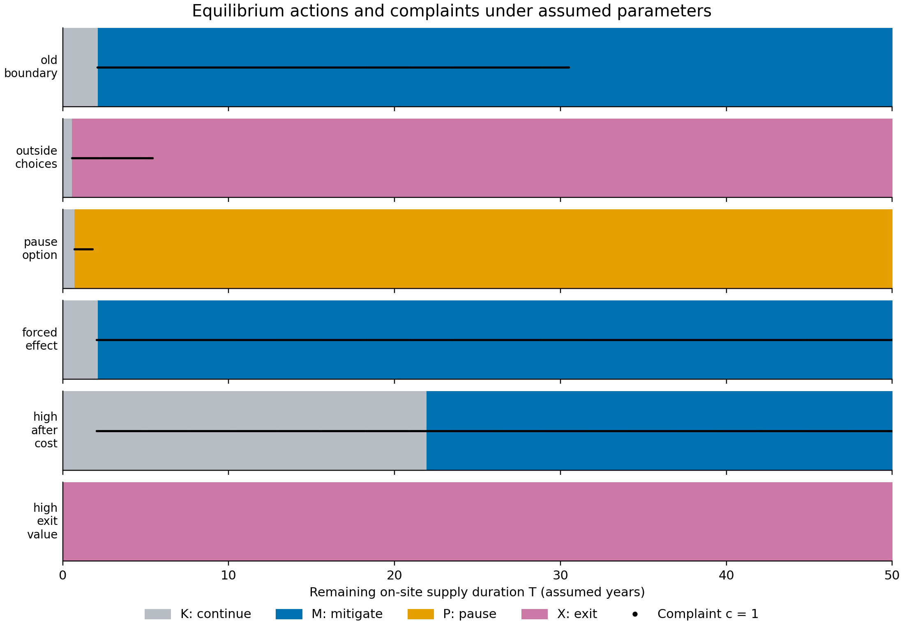

# AI算力中心地缘冲突

**电力约束下，AI算力中心地缘冲突的策略选择：时间价值、可信缓解与退出**

研究报告 / Working Paper · 2026-11-17

本研究通过单轮完全信息序贯博弈，分析供电等待时间、执行规则与企业外部选择如何共同影响社区投诉和开发商响应。社区先决定是否投诉，开发商随后选择继续运行、主动缓解、暂停待网或退出。

## 主要发现

- 相同投诉状态可以对应不同企业行动和损害水平，需要联合观察投诉、行动与结果。
- 在外部选择受限且无直接技术纠正的条件下，投诉可集中在能够诱发缓解的中间期限。
- 暂停、退出与技术纠正改变这一策略区域；技术纠正的成本和减损效果同时进入支付。

## 阅读与数据

- [在线阅读入口](index.html)
- [论文正文（Markdown）](paper/论文定稿.md)
- [理论与复算附录](paper/理论与复算附录.md)
- [证据与文献附录](paper/证据与文献附录.md)
- [策略情景数据](paper/图表数据/情景48行.csv)
- [模型与测试](paper/计算代码/v0.4.1/)



模型给出条件性理论结果。VA2与Stafford Technology Campus的公开材料用于说明制度机制；数值情景采用假设参数。

## 本地阅读

直接打开`index.html`即可阅读全文，图片已嵌入该文件。也可以在本目录运行：

```sh
python3 -m http.server 8000
```

然后访问本机的8000端口。

## 复算

模型与测试仅依赖Python 3标准库，无需安装第三方包。在仓库根目录执行：

```sh
python3 paper/计算代码/v0.4.1/test_model.py
python3 paper/计算代码/v0.4.1/model.py
```

测试预期9项通过，包含150组状态枚举和70组旧版比较；生成48行情景，结果写入`paper/计算代码/v0.4.1/`。保留同级`v0.4/model.py`，它是旧版比较的测试依赖。论文图表数据保存在`paper/图表数据/`。

## 文件结构

```text
index.html        全文阅读页
paper/            正文、附录、图表、数据和计算代码
SHA256SUMS.txt    发布文件校验清单
```
