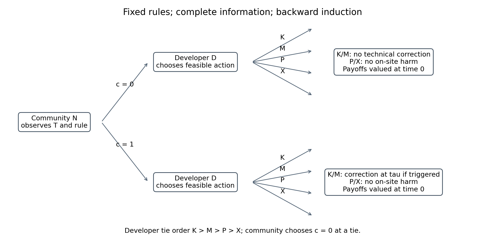
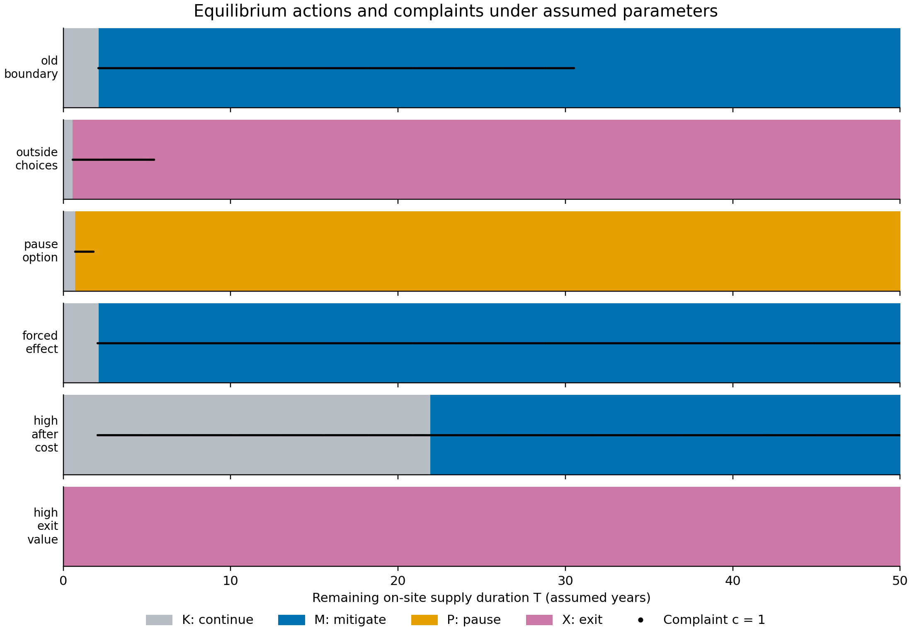

# 电力约束下，AI算力中心地缘冲突的策略选择：时间价值、可信缓解与退出

## 中文摘要
电力约束延长数据中心现场供电期，也改变社区投诉所能带来的结果。本文构建单轮完全信息博弈：社区先决定是否投诉，开发商再选择继续运行、主动缓解、暂停待网或退出，给定执行程序决定技术纠正。研究发现，相同投诉状态可以对应不同企业行动和损害水平。无技术纠正且外部选择不可行时，投诉在能够诱发缓解、且减损收益超过投诉成本的中间期限出现；较短期限和较长期限均可沉默，分别伴随继续运行与主动缓解。允许暂停和退出后，沉默又可伴随现场影响停止。可执行纠正则使投诉与主动缓解并存：两条条件响应均为主动缓解时，社区仍可在最初选择投诉，以获得执行程序带来的追加减损。本文以弗吉尼亚州两个项目的制度观察和假设参数情景说明这些路径。贡献在于明确期限、执行规则与外部选择如何改变投诉状态所对应的结果，提出应联合观察投诉、企业行动与损害的检验路径。AI时间价值构成应用背景，模型适用于一般高负荷数据中心。

关键词：数据中心；电力约束；环境投诉；地方外部性；可信缓解；退出

## Abstract
Electricity constraints can extend on-site power generation at data centers and alter what communities gain from complaining. This paper develops a single-round, complete-information game: a community first chooses whether to complain, and a developer then chooses continued operation, voluntary mitigation, a pause until grid connection, or exit. An exogenous enforcement procedure determines technical correction. The same complaint status can correspond to different developer actions and levels of harm across scenarios. Without technical correction or outside options, complaints occur over an intermediate range of durations when they induce mitigation and its benefit exceeds complaint costs. Silence accompanies continued operation at shorter durations and voluntary mitigation at longer durations. With pause and exit available, silence can also accompany the cessation of on-site impacts. Enforceable correction permits complaints and voluntary mitigation to coexist: even when mitigation is the developer's response in both contingent branches, the community can initially choose to complain for the additional reduction in harm delivered by enforcement. Institutional observations from two Virginia projects and assumed-parameter scenarios illustrate these paths. The contribution specifies how exposure duration, enforcement rules, and outside options shape the outcomes behind a complaint indicator. It motivates joint observation of complaints, firm actions, and harm. AI deployment incentives provide context; the strategic structure also applies to other high-load data centers.

Keywords: data centers; electricity constraints; citizen complaints; local externalities; credible mitigation; exit

## 1 引言

同样是没有投诉，一个数据中心可能继续承担较高现场影响，也可能主动缓解、暂停待网或退出；同样是发生投诉，企业可能改变行动，也可能保持行动而由执行程序减少损害。投诉记录因此只呈现地方冲突的一部分。本文关注这些路径何时出现，以及电网接入的剩余等待时间如何改变它们。这里的“地缘冲突”指围绕项目区位、运行方式和地方外部性的利益冲突，分析单元是开发商与其周边社区。

电网接入滞后使这一问题具有时间维度。国际能源署将接网排队与电力设备交付列为数据中心部署的约束，并指出高资本密集度增加了AI数据中心削减运行的成本（International Energy Agency，2025）。企业在接网前采用现场供电，可以提前提供算力服务，社区则经历持续的设备运行影响。等待越长，既增加累计暴露，也改变缓解投入是否值得实施，以及保留项目、暂停或退出的相对价值。投诉的收益取决于这些企业选择能够被改变多少。

本文构建单轮完全信息序贯博弈。社区首先在投诉和沉默之间选择，开发商随后在继续运行、主动缓解、暂停待网和退出中响应，政府按给定规则执行。社区在作出最初选择时比较两条条件响应的终局损害。可信缓解被操作化为持续有效的主动措施及可执行的技术纠正：措施有明确成本、减损效果和覆盖期限。承诺的可信度是给定安排的属性，模型不另行求解企业如何建立声誉或选择承诺强度。

分析的主线是投诉状态与冲突结果之间的对应关系。首先，在无技术纠正、暂停和退出不可行的条件下，中间期限可以出现投诉诱发缓解，而更短和更长的期限均为沉默，分别对应继续运行和主动缓解。其次，暂停和退出使沉默与投诉都能够对应现场影响停止，原有缓解路径由此改变。最后，即使开发商在两条条件路径都选择主动缓解，社区仍可在最初选择投诉，通过执行程序取得额外减损。投诉与主动缓解在同一个均衡中并存，无需引入第二次投诉。

这些结果说明，在不同期限、执行规则和外部选择条件之间比较时，仅凭投诉状态无法判断企业行动与残余损害。给定完整参数和同值规则后，模型选择唯一结果；跨情景出现相同投诉状态，来自情景之间的条件差异。本文以此提出观测变量的选择要求，不建立基于有限数据恢复结构参数的计量识别定理。

研究将弗吉尼亚州Vantage Ashburn II园区（VA2）和Stafford Technology Campus（STC）作为制度观察，展示供电期限、证据要求和持续缓解安排如何进入分析。与既有投诉—监管研究相比，本文的增量在于有限供电期内企业外部选择及纠正成本共同形成的路径边界。AI部署的时间价值解释应用背景；模型结构同时适用于具有现场供电和地方外部性的一般高负荷数据中心。

## 2 制度背景与案例观察

### 2.1 VA2：运行影响如何进入执行程序

VA2体现了项目批准、现场运行与投诉处理之间的不同环节。Loudoun County的2023年行动报告记录相关分区与特别许可申请获批，议程摘要则记载相应听证事项没有公众发言（Loudoun County Board of Supervisors，2023a，2023b）。前者是行政决定，后者是特定参与程序中的观察。本文以向有权机关提出处理请求界定投诉，分别处理会议参与、一般态度和行政投诉。

县政府2026年会议材料回溯称，VA2燃气轮机在完全接网前承担主要供电；材料也说明噪声执法要求特定测量方法。环境质量部门的演示记载，其于7月17日响应公众投诉，对EG-7进行可见排放评估，8月4日警告函要求维护及反馈，并安排收到结果后复测（Loudoun County，2026，第11、17、46页）。公开观察至此呈现的是投诉进入检查和技术行动要求的路径。

这一路径具有两层机制含义。其一，现场供电使接网日期成为影响持续时间的边界。其二，投诉的作用依赖可适用的义务、证据标准和处理权限；影响被感知、被正式确认及能够被纠正，是不同环节。噪声测量和EG-7排放处理分别说明证据与技术执行机制。企业改善设施与行政执行要求也应分别观察，才能判断减损究竟经由哪条路径发生。

### 2.2 STC：持续缓解的制度安排

STC提供了另一种制度观察：将缓解要求与设计、专业测量和后续责任连接。Stafford County的2026年议程所附承诺文本列有噪声限制、突出离散音调的调整、第三方测量及声学研究；必要缓解措施与场地、建筑方案相联系，并设入住后的测量和年度安排（Stafford County Board of Supervisors，2026，第385—387页）。这些设计将缓解从单次工程投入延伸为持续有效的运行要求。

同一议程包含开发商偿付第三方审查费用的安排与支出说明（Stafford County Board of Supervisors，2026，第373页）。它提示企业所面对的费用并不限于设备改造：审查、报告和专业服务也会影响运行路径的成本。不过，程序服务与实际减损是不同对象。经济分析需要同时记录企业为执行程序付出了什么，以及社区暴露发生了什么变化。

两个项目使模型中的三个维度具体化：影响持续多久、投诉经何种程序产生后果、缓解能否持续实施。本文以公开材料中的制度观察构造问题；案例不是因果对照，数值情景也不以两项目为校准对象。适用义务和执行效果的个案确认留在证据附录，正文据此将执行规则作为给定条件，分析不同条件下社区与企业的选择。

## 3 相关文献与研究定位

设施选址研究将地方接受程度与风险认知、信任和补偿联系起来。Kunreuther等（1990）讨论公众风险判断及货币补偿的作用，Frey和Oberholzer-Gee（1997）分析不受欢迎设施选址中的激励与内在动机。本文保留实际损害减少作为社区收益，不设置补偿谈判。与这类研究的连接是把持续减损作为独立行动：企业支付了一项费用与社区获得了一项改善，需要在支付结构中分别表示。

投诉与监管的联系已有直接研究。Dasgupta和Wheeler（1997）讨论污染可见性和社区特征如何影响投诉信息。Colmer等（2024）区分公众信息、调查发现和监管资源，其研究设计使用设施月度面板的局部投影，因果解释依赖条件独立性；文中也讨论了调查资源挤出和福利评价的边界。其制度讨论指出，投诉通常触发机关调查，违规认定仍需相应证据（第4.1—4.5节）。这些区分为本文固定执行规则的设定提供了直接参照。

Maniloff和Kaffine（2021）以油气井研究投诉跟进检查及针对具体资产的监管响应。投诉触发检查和监管注意力的配置均已有研究。企业是否改变运行或采取措施，则需要与监管调查、通知分别观测。本文不以这些联系本身作为新发现。尤其是，程序启动、企业主动缓解和技术纠正属于不同观测环节；本文将企业行动显式列入支付比较，讨论其如何与投诉选择共同决定损害。

本文选择一个较窄的理论问题：给定处理规则和剩余期限，社区在最初行动时预期企业如何响应，而企业可以主动缓解、保留接网机会或退出。固定规则使分析集中于私人选择，监管部门的预算分配和信息判断不作为新的策略。因而，本文与最接近文献的连接是有限期限和外部选择的条件比较，而非重新证明公众信息有用，或把企业收到行政要求直接等同于主动投资。

等待与退出文献为这一行动集提供基础。Dixit（1989）分析随机价格、进入退出成本与行动阈值。本文采用确定的接网期限，暂停一旦选择即持续到接网；其价值来自保留未来经营机会，同时承担停复机和待机成本。退出则放弃该经营价值，换取回收净值。这一有限期比较能够解释为什么同一投诉压力下，有的情景产生缓解，有的产生暂停或退出。随机期限与反复停复机属于另一层动态问题。

数据中心能源文献提供时间价值的行业背景。国际能源署（2025）讨论接网约束与负载灵活性，Newkirk等（2026）的预印本把建设速度及可获得算力价值纳入不同供电方案的经济比较。本文以运行净流和接网终值表达这些收益，不采用其数值估计，也不预设所有数据中心负载具有相同时间敏感性。案例AI用途尚未验证；本文的机制贡献来自地方冲突中的行动比较。

由此，本文的贡献包含两个相互连接的内容：一是给出T如何移动投诉诱发缓解、无需投诉的缓解以及暂停退出路径的边界；二是给出在两条企业条件响应相同的情况下，投诉通过技术执行仍有收益的条件。命题1和3提供支付比较基础，命题2、命题4及外部选择的变化承担主要分析。最终得到的是对投诉记录的结构化解释：相同的单个指标可以来自不同均衡路径，研究应进一步观察企业行动与残余损害。

## 4 模型

### 4.1 主体、时序与行动

设社区为N，开发商为D。时点0双方知道剩余现场供电期限T、贴现率ρ、支付参数和执行规则。社区先选择c∈{0,1}，分别表示沉默和投诉。开发商观察后选择继续运行K、立即主动缓解M、暂停待网P或退出X。P仅在技术条件和合同条件均允许时可选，X有独立可行性条件。政府不是策略玩家；其处理流程作为共同已知的规则。图1给出行动树。

图1注：两条投诉分支均求开发商最优响应。K、M后的技术纠正须满足相同触发条件；P、X不产生本模型内的现场影响。图中文字采用英文缩写，定义与正文一致。

接网发生于T，届时结束本文所计的现场供电影响。定义折现暴露量A(T)=∫₀ᵀe^(−ρt)dt；ρ>0时为(1−e^(−ρT))/ρ，ρ=0时为T，记d=e^(−ρT)。u为现场运行收入减供电与基础维护成本的年净流，G为接网时点的后续经营价值，因此继续运行的共同经营项为Π=uA+dG。已经发生的投资属于沉没支出，不重复扣除。G只进入企业收益，不自动解释为社区税收或就业收益。

### 4.2 规则、成本与纠正时点

规则分为可执行、无适用义务、证据不符合要求、证据有效但符合标准、无纠正权限五类。后三类与无义务类别在本模型中具有相同支付处理，但保留不同制度含义：可执行类别之外，程序成本流和技术纠正均设为零，一次投诉处理费仍保留。可执行类别表示适用路径允许按预设规则形成程序及纠正后果，并非对具体案件的法律定性。

在可执行类别，K的年度程序及常规维护成本为j_c，即无投诉时j₀、有投诉时j₁；M的对应残余成本为ℓ。自愿缓解一次投入C，投诉另产生一次处理费f。这些成本项的经济范围相互区分，详细映射见附录。所有货币以时点0为估值基准；社区损害和投诉成本使用另一套效用单位。

设未缓解损害流为h，主动缓解减少δ，满足h≥δ≥0。技术纠正按给定时点τ发生，其最大减损流为g。令m=0对应K、m=1对应M，实际纠正减损r_m=min{g,h−δm}。仅当执行机制开启、规则可执行、c=1、τ<T且r_m>0时，指示量I_m=1。相应成本和折现减损为

F_m=I_m e^(−ρτ)Q_m，　B_m=I_m r_m[A(T)−A(τ)]。　（1）

Q₀和Q₁分别是未主动缓解与已主动缓解状态的一次技术纠正费。两者可以不同。T≤τ时，接网取消尚未实施的现场纠正，成本和效果同时为零；这是一项明确的时点约定。g=0或残余损害为零时也不触发技术行动。主动缓解效果持续至T，且不计设备残值。这样的可信缓解安排给定了履行与效果，不包含欺骗、违约或再谈判。

### 4.3 支付与均衡选择

给定c，企业的四项支付为

V_K=Π−fc−j_cA−F₀；

V_M=Π−C−fc−ℓA−F₁；

V_P=−S−wA+d(G−R)−fc；

V_X=L−D_e−Q_cl−fc。　（2）

S、R分别为停机和接网重启成本，w为待机成本流；L为退出可回收价值，D_e为解约成本，Q_cl为清理费用。P保留接网后的经营价值，X不保留G；两者均取消尚未实施的技术纠正。既有不可解除的法律债务不在当前支付中。

社区损害为H_K=hA−B₀、H_M=(h−δ)A−B₁、H_P=H_X=0，收益为−H_a−kc，k为投诉成本。社区没有企业利润或地方就业效用项，因而退出对社区的含义仅是本文关注的损害停止。

社区只有这一次投诉选择；技术纠正是该次选择对应的执行后果。用逆向归纳求解。开发商同值时按K、M、P、X顺序选择；社区同值时沉默。记两个投诉分支中的最优行动为a₀、a₁，则投诉当且仅当

H(a₀,0)−H(a₁,1)>k。　（3）

行动同值规则使边界结果唯一，不构成有关企业真实偏好的经验结论。式（3）比较完整响应路径；仅比较K与M会在外部选择具有吸引力时误判投诉收益。

## 5 均衡与比较静态

### 5.1 缓解的私人阈值

**命题1。** 在给定投诉状态和可执行规则下，M优于K当且仅当(j_c−ℓ)A>C+F₁−F₀；等号选择K。M成为全局最优还须同时满足对P、X的比较条件。

命题由两项支付相减得到。主动缓解的私人收益是减少程序成本，以及改变后续纠正成本；社区减损δ不直接进入企业收益。提高δ仅在改变技术纠正触发或成本设定、或者改变社区投诉时，间接影响企业均衡。这说明设备改善与企业实施激励须分别识别。投诉处理费f在同一分支所有行动中相同，故不改变企业排序；它仍减少企业终局收益。

在行动和触发状态固定的区间内，A′(T)=e^(−ρT)>0。若j_c>ℓ，延长期限增加主动缓解相对继续运行的节约。正贴现下A有上界1/ρ；当C≥(j_c−ℓ)/ρ且F₀=F₁=0时，再长的有限期限也不足以严格跨过缓解阈值。有限期限与贴现共同决定阈值能否到达。

### 5.2 中间期限投诉的成立条件

**命题2。** 设规则可执行，g=0，P和X不可行，C>0、δ>0、k≥0，并有j₁>j₀>ℓ。定义a₁*=C/(j₁−ℓ)、a₀*=C/(j₀−ℓ)。投诉均衡恰在

max{a₁*,k/δ}<A(T)≤a₀*　（4）

且A(T)为有限期限可达值时出现，终局为M。A≤a₁*时两条路径均选K；A>a₀*时两条路径均选M，社区均沉默。

这一均衡同时满足两个阈值：投诉路径使缓解成为企业更优响应，且预期损害下降大于k。在式（4）右端，沉默路径K与M同值且选K，投诉仍能诱发M；超过右端后，企业无需投诉也选M。若下界不低于可达上界，投诉区间为空。因而“中间期限投诉”是带有参数和行动集条件的结果，而非T的普遍单峰关系。

这一结果也区分两种沉默：短期限沉默伴随K，长期限沉默伴随M。若只观察投诉次数，两者相同；若同步观察设备投入和残余损害，路径不同。相应的观测应同时覆盖无投诉状态下的企业行动及投诉路径中的措施。

### 5.3 暂停和退出改变策略区域

**命题3。** 在给定c和可执行规则下，M弱优于P的条件为

(u+w−ℓ)A+dR+S≥C+F₁，　（5）

M弱优于X的条件为

uA+dG−C−ℓA−F₁≥L−D_e−Q_cl。　（6）

式（5）、（6）等号均选择M。P严格优于K当且仅当(j_c−u−w)A+F₀>S+dR。X须严格超过所有更早的可行动作。

式（5）保留了暂停的机会成本：M获得现场净收入，P承担待机和停复机费用。相同G从M与P的差额中抵消，但在M与X的比较中保留。因此，较高接网后价值会提高保留项目相对退出的吸引力，而不会直接改变M与P的排序。提高S或w削弱暂停，提高可回收价值L则提升退出；这些变化均须在其他支付固定时解释。

若在两条投诉路径中企业都暂停或退出，社区的损害差为零，因而选择沉默。若投诉把K变为P或X，社区获得hA的减损，条件变为hA>k。外部选择因此可能取代M成为投诉后的响应。总体上，较长等待既累积损害，也改变等待经营的价值；其最终方向取决于净运行流、停复机成本和退出净值，不能从暴露量单独推出。

### 5.4 纠正的直接收益与技术成本

**命题4。** 在规则可执行、T>τ、技术机制开启且无投诉与有投诉两条条件响应均为同一现场行动m的区间，社区投诉当且仅当r_m[A(T)−A(τ)]>k。社区预期的企业行动相同，执行后果仍可不同。

当主动缓解仍留下正损害，即使a₀=a₁=M，社区也可在最初选择c=1，以获得该次投诉所触发的技术纠正减损。另一方面，F₁−F₀进入命题1：若主动缓解后的追加纠正更昂贵，其成本可能使M让位于K；若缓解消除了全部剩余损害，M后的技术纠正不触发。可执行纠正既有对社区的直接减损效应，也有通过企业行动产生的间接效应。

在固定行动及触发区间内，推迟τ使社区获得的纠正减损减少；正贴现下也降低一次支出的现值。在τ到达T时，本模型同时取消该支出和减损，支付发生分段变化。跨越行动边界时，总损害变化还包含企业重新选择的影响。比较不同执行时点时，需要报告全部响应而不是只报告纠正覆盖了多少年。

### 5.5 从投诉状态到结果路径

式（3）说明，投诉针对的是两条响应路径的损害差，而不是无条件的损害水平。当两条路径均为K且没有直接纠正时，损害可以为正而社区选择沉默；当两条路径均为M时，沉默可以伴随较低的损害流；当两条路径均停止现场运行时，沉默又对应本项损害为零。反过来，c=1可以与M、P、X以及带技术纠正的K分别组合。

这里的多条路径是跨期限或跨参数情景的比较。给定同一完整参数组、同一T和同值规则，逆向归纳只选一个结果。若研究者只保留c，相当于将企业行动和损害信息从结果中删去；本文的例证展示这种简化如何丢失机制信息。它不声称在给定一套统计数据和估计方法后已证明参数不可识别。

T的作用也因路径而异。固定行动时，延长期限增加折现暴露量；越过企业行动边界时，损害又受行动切换影响。因此，即使较长期限伴随较少投诉，实际影响仍须由相应行动和剩余损害共同判断。命题2提供期限改变沉默含义的解析例子，命题4提供企业条件行动相同而投诉仍有收益的例子，P和X则扩展了这两类关系的行动集合。

## 6 数值情景与机制讨论

### 6.1 假设参数与策略展示

数值情景采用年为时间单位；企业使用规范化货币单位，社区使用规范化效用单位，两者不相加为社会福利。全部数值均为假设值。基本参数为ρ=0.03、C=4、k=1、j₀=0.2、j₁=2、ℓ=0、h=3、δ=2.5、f=0.2。技术纠正情景取τ=1、g=1、Q₀=Q₁=1。各情景的运行流、终值、退出净值和可行性开关详列附录，不解释为案例估计。

图2在T∈[0,50]上展示六种情景，颜色代表终局行动，黑点代表投诉。表1选取若干期限，列出沉默和投诉后的条件行动及均衡损害。基本情景无外部选项、无直接纠正，u=G=0；其投诉诱发缓解阈值约为2.06年，无投诉缓解阈值约为30.54年。社区减损阈值约0.40年，因而在这一参数组中不构成主要限制。

图2注：old_boundary为基本情景；outside_choices为允许外部选择；pause_option为低运行流的暂停情景；forced_effect为技术纠正；high_after_cost将Q₁改为30；high_exit_value为高回收价值。网格步长0.05年，解析边界以正文命题为准。

|情景|T（年）|沉默后行动|投诉后行动|均衡投诉|终局|损害现值H|
|---|---:|---|---|---:|---|---:|
|基本情景|1|K|K|0|K|2.955|
|基本情景|31|M|M|0|M|10.091|
|低运行流、可暂停|10|P|P|0|P|-0.000|
|允许外部选择|10|X|X|0|X|-0.000|
|基本情景|10|K|M|1|M|4.320|
|已缓解后纠正昂贵|10|K|K|1|K|18.264|
|低运行流、可暂停|1|K|P|1|P|0.000|
|允许外部选择|1|K|X|1|X|0.000|

表1注：均为假设参数。H以规范化社区效用计，排除投诉成本k；K继续、M主动缓解、P暂停、X退出。前四行c=0，后四行c=1，各自覆盖四种企业行动。行间期限和参数不同，表中比较的是相同投诉状态下可出现的结果路径。

### 6.2 三种机制区分

第一，允许外部选择的情景将基本情景的运行流与终值维持为零，退出净值为−1。T=1时投诉后的程序成本足以使企业退出，而沉默时仍继续；T=10时两条路径均退出，社区不再支付投诉成本。该情景突出退出选项如何切断原有“投诉—主动缓解”链条。它不用于说明现实企业缺少经营收益，而是通过保持其余项不变展示外部选项的作用。

第二，低运行流情景令u=−1.1、G=10、S=R=1、w=0.2、退出解约成本20。较早暂停保留接网价值，避免现场经营亏损。T=1时投诉促使暂停，T=10时企业在沉默路径已暂停。与退出相比，P在未来接网时恢复经营，这使停运观测必须进一步区分“等待”与“放弃”。只把所有停运编码为退出，会丢失G在企业决策中的作用。

第三，在技术纠正情景中，T=31时a₀=a₁=M，社区在最初比较两条路径时，因投诉路径的技术纠正能够进一步减少损害而选择c=1。把Q₁提高到30后，T=10的企业两条路径均为K，投诉通过法定技术行动而非主动缓解改善社区收益。这两种路径说明，相同投诉状态可以对应不同企业行动，而相同企业行动也可以伴随不同的执行效果。记录技术措施的发起依据和实施时点，是区分机制的必要数据。

### 6.3 解释范围与经验区分

论文中的“时间价值”包括现场净流、折现暴露量及接网终值。它没有单独刻画芯片迭代、训练任务截止日期、客户流失或AI算力租约。将这些因素纳入实证时，应先判断其影响u、G还是暂停可行性，再避免跨项重复计价。AI负载具有较高时间敏感性的研究背景，不足以把VA2或STC每一单位容量都认定为AI用途。

可信缓解的经验含义取决于适用义务、专业验证和实际持续效果。模型把这些环节压缩为给定规则和确定效果，适合描述条件响应。经验检验则应允许执行不确定性、多个社区和多次投诉，并记录接网后仍持续的其他影响。特别是暂停和退出若保留既往法律负债，需重新构建相应净值；本文现有阈值只适用于未实施纠正随现场运行停止而取消的范围。

## 7 结论与经验检验路径

投诉状态与地方冲突结果之间存在多条条件路径。本文的单轮博弈中，沉默可以伴随继续运行、主动缓解、暂停或退出；投诉既能通过改变企业行动减少损害，也能在企业条件响应相同的情况下，经由执行程序产生直接减损。剩余现场供电期限改变各路径的收益与边界，使投诉和损害之间的对应关系随运行和制度条件变化。

主要结果集中在三个方面。无技术纠正且外部选择不可行时，投诉只在其能诱发缓解、且增量减损超过参与成本的期限区间发生。允许暂停和退出后，投诉的收益可以来自现场运行停止，沉默也可以伴随这一结果。技术纠正可执行时，社区在预期两条条件路径都采取M的情况下仍会选择投诉，从而出现投诉与主动缓解并存。整个过程中，社区只有一次投诉决策。

这些发现要求经验研究联合观察投诉、企业行动和损害。仅统计投诉的项目数或频次，会把不同运行路径合并；仅记录主动缓解，也会遗漏暂停退出和法定技术行动。模型中的c是一次决策指标，经验中的频次则可能由重复事件和多个社区构成。将模型用于面板研究时，应先界定一次决策的观测窗口，并区分首次投诉、重复投诉与企业响应的先后关系。

可检验预测应以条件组呈现。外部选择受限且投诉只影响程序成本时，等待期限变化可能产生K—投诉诱发M—无需投诉M的路径；净运行流较低而接网价值较高时，P更具吸引力；退出净值提高时，X更容易进入响应。两条条件路径均为M且剩余影响可纠正时，投诉与技术执行应共同出现。上述方向应与相应合同、成本和规则变量一起检验，而非用统一的投诉—期限斜率替代。

研究资料应覆盖有投诉和无投诉项目，并连接供电安排、投诉受理、企业行动及负荷可比的损害测量。恢复真实反事实还需要明确外生变化、共同冲击及选择过程；本模型没有规定一种自动有效的计量设计。两个案例用于辨认制度环节，假设情景用于展示可能路径。论文所提供的起点是可核查的问题划分：在特定期限和规则下，投诉能改变什么，企业选择什么，以及社区最终承担多少影响。

## 参考文献

Colmer, J., Evans, M. F., & Shimshack, J. (2024). *Environmental citizen complaints* (CEP Discussion Paper No. 1903, revised November 2024). Centre for Economic Performance, London School of Economics and Political Science. [修订工作论文](https://cep.lse.ac.uk/pubs/download/dp1903.pdf)

Dasgupta, S., & Wheeler, D. (1997). *Citizen complaints as environmental indicators: Evidence from China* (Policy Research Working Paper No. 1704). World Bank. [官方工作论文](https://documents1.worldbank.org/curated/en/450781468746709957/pdf/multi-page.pdf). [DOI](https://doi.org/10.1596/1813-9450-1704)

Dixit, A. (1989). Entry and exit decisions under uncertainty. *Journal of Political Economy, 97*(3), 620–638. [DOI](https://doi.org/10.1086/261619)

Frey, B. S., & Oberholzer-Gee, F. (1997). The cost of price incentives: An empirical analysis of motivation crowding-out. *American Economic Review, 87*(4), 746–755. [JSTOR稳定标识](https://doi.org/10.2307/2951373). [作者提供原文](https://www.bsfrey.ch/wp-content/uploads/2021/08/the-cost-of-price-incentives-an-empirical-analysis-of-motivation-crowding-out.pdf)

International Energy Agency. (2025). *Energy and AI*. [官方报告执行摘要](https://www.iea.org/reports/energy-and-ai/executive-summary)

Kunreuther, H., Easterling, D., Desvousges, W., & Slovic, P. (1990). Public attitudes toward siting a high-level nuclear waste repository in Nevada. *Risk Analysis, 10*(4), 469–484. [DOI](https://doi.org/10.1111/j.1539-6924.1990.tb00533.x)

Loudoun County. (2026, August 24). *Vantage Data Center Town Hall* [县政府、DEQ及运营商会议演示资料]. [官方演示资料](https://www.loudoun.gov/DocumentCenter/View/222097/August-2026-Vantage-Town-Hall_Final)

Loudoun County Board of Supervisors. (2023a, March 21). *Board Business Meeting Action Report* (Item 3, p. 5). [官方行动报告](https://loudoun.granicus.com/MetaViewer.php?clip_id=7225&meta_id=226698&view_id=89)

Loudoun County Board of Supervisors. (2023b, March 21). *Board Business Meeting Agenda Summary* (Item 3, p. 4). [官方议程摘要](https://loudoun.granicus.com/MetaViewer.php?clip_id=7225&meta_id=226461&view_id=89)

Maniloff, P., & Kaffine, D. T. (2021). Private monitoring and public enforcement: Evidence from complaints and regulation of oil and gas wells. *Journal of Environmental Economics and Management, 108*, 102473. [DOI](https://doi.org/10.1016/j.jeem.2021.102473)

Newkirk, A. C., Gerber, D. L., Fuchs, E. R. H., Hubbard, A., Morgan, M. G., Shehabi, A., Smith, S. J., & Samaras, C. (2026). *Speed-to-power dominates energy costs for AI data centers: Technoeconomic analysis of powering AI in the continental United States* (arXiv:2611.17098v1) [预印本]. [版本化来源](https://arxiv.org/abs/2611.17098v1). [arXiv DOI，页面标示注册待处理](https://doi.org/10.48550/arXiv.2611.17098)

Stafford County Board of Supervisors. (2026, October 7). *Board of Supervisors Agenda Packet* (pp. 372–398，STC事项及所附承诺文本). [官方议程包](https://staffordcova.api.civicclerk.com/v1/Meetings/GetMeetingFileStream(fileId=6347,plainText=true))
